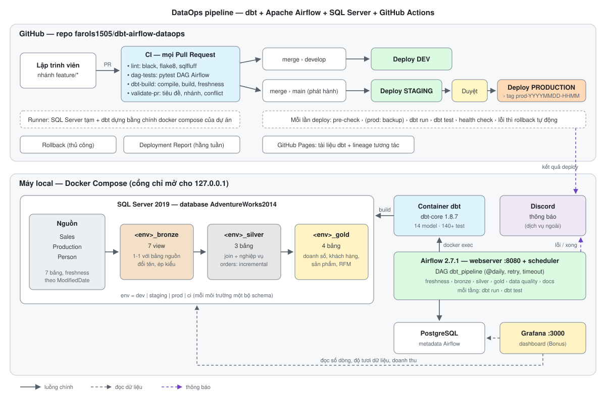

# DataOps Pipeline — dbt + Apache Airflow + SQL Server

[](https://github.com/farols1505/dbt-airflow-dataops/actions/workflows/ci.yml)
[](https://github.com/farols1505/dbt-airflow-dataops/actions/workflows/deploy.yml?query=branch%3Adevelop)
[](https://github.com/farols1505/dbt-airflow-dataops/actions/workflows/deploy.yml?query=branch%3Amain)
[](https://farols1505.github.io/dbt-airflow-dataops/)

Pipeline dữ liệu tự động theo tinh thần **DataOps**: biến đổi dữ liệu bán hàng **AdventureWorks2014** (SQL Server) bằng **dbt** theo kiến trúc medallion, điều phối hằng ngày bằng **Apache Airflow**, kiểm thử và triển khai tự động bằng **GitHub Actions** qua 3 môi trường **dev → staging → production**.

> Đồ án môn Advanced DevOps — DataOps (HCMUS). Đề bài: [`docs/course/4. DATAOPS_PROJECT_REQUIREMENTS.md`](docs/course/4.%20DATAOPS_PROJECT_REQUIREMENTS.md).

---

## Mục lục

- [Kiến trúc](#kiến-trúc)
- [Tính năng chính](#tính-năng-chính)
- [Cài đặt nhanh](#cài-đặt-nhanh)
- [Chạy pipeline](#chạy-pipeline)
- [CI/CD và quy trình phát triển](#cicd-và-quy-trình-phát-triển)
- [Giám sát](#giám-sát)
- [Cấu trúc thư mục](#cấu-trúc-thư-mục)
- [Xử lý sự cố](#xử-lý-sự-cố)
- [Tài liệu](#tài-liệu)
- [Khai báo sử dụng AI](#khai-báo-sử-dụng-ai)

---

## Kiến trúc



| Thành phần | Công nghệ | Vai trò |
|---|---|---|
| Nguồn dữ liệu | SQL Server 2019 + AdventureWorks2014 | Dữ liệu bán hàng (đơn hàng, khách hàng, sản phẩm) |
| Biến đổi | dbt-core 1.8.7 + dbt-sqlserver | 3 tầng **bronze → silver → gold**, 14 model, 140+ test |
| Điều phối | Apache Airflow 2.7.1 | DAG `dbt_pipeline` chạy hằng ngày, retry, kiểm tra chất lượng, thông báo |
| CI/CD | GitHub Actions | Kiểm tra mọi Pull Request; tự deploy khi merge; rollback |
| Giám sát | Grafana 13 + Discord | Dashboard pipeline/dữ liệu; thông báo khi lỗi |
| Hạ tầng | Docker Compose | 5 container (+ Grafana tùy chọn) |

**Luồng dữ liệu:** `AdventureWorks (Sales, Production, Person)` → `<env>_bronze` (7 view) → `<env>_silver` (3 bảng) → `<env>_gold` (4 bảng) → dashboard / báo cáo. Chi tiết: [`docs/ARCHITECTURE.md`](docs/ARCHITECTURE.md), lineage: [`docs/LINEAGE.md`](docs/LINEAGE.md).

---

## Tính năng chính

| Yêu cầu | Cách đáp ứng |
|---|---|
| **dbt models** | Bronze 1-1 với 7 bảng nguồn; silver join + logic nghiệp vụ (incremental cho bảng lớn); gold gồm doanh số theo ngày, chỉ số khách hàng, hiệu quả sản phẩm, phân khúc RFM. Mọi model/cột có mô tả |
| **Kiểm thử** | `not_null`, `unique`, `relationships`, `accepted_values`, 4 generic test tự viết, 3 singular test đối soát nghiệp vụ, source freshness cho mọi nguồn → [`docs/TESTING.md`](docs/TESTING.md) |
| **Airflow** | DAG theo tầng (run → test từng tầng), retry tăng dần, timeout, SQL data quality checks, thông báo Discord |
| **CI** | black, flake8, sqlfluff, pytest DAG, `dbt compile` + `dbt build` trên SQL Server tạm, kiểm tra tiêu đề PR / tên nhánh / file lớn / xung đột, sinh tài liệu |
| **CD** | Merge `develop` → deploy **dev**; merge `main` → **staging** → duyệt → **production**; pre-deploy validation, backup, health check, rollback tự động, tag phiên bản, thông báo |
| **Giám sát deploy** | Lịch sử phiên bản (tag `prod-*`), báo cáo tỉ lệ thành công hằng tuần, runbook, quy trình rollback |
| **Bonus** | Dashboard Grafana · Lineage tương tác trên GitHub Pages · 3 môi trường dev/staging/prod |

---

## Cài đặt nhanh

Yêu cầu: Docker (Compose v2), Git, Python ≥ 3.9, 8 GB RAM. Hướng dẫn đầy đủ (< 30 phút): [`docs/SETUP_GUIDE.md`](docs/SETUP_GUIDE.md).

```bash
git clone git@github.com:farols1505/dbt-airflow-dataops.git dbt_airflow_project
cd dbt_airflow_project
cp .env.example .env              # rồi điền mật khẩu + khóa Fernet (xem chú thích trong file)
docker compose build
docker compose up -d
./scripts/init_sqlserver.sh       # restore AdventureWorks + tạo tài khoản dbt
docker compose exec dbt dbt deps
docker compose exec dbt dbt build --full-refresh
```

| Dịch vụ | Địa chỉ | Đăng nhập |
|---|---|---|
| Airflow | http://localhost:8080 | `admin` / `AIRFLOW_ADMIN_PASSWORD` |
| SQL Server | `localhost,1433` | `sa` / `SA_PASSWORD` |
| Grafana (tùy chọn) | http://localhost:3000 | `admin` / `GRAFANA_ADMIN_PASSWORD` |

---

## Chạy pipeline

**Bằng Airflow (cách chính):** mở Airflow → DAG **`dbt_pipeline`** → bật công tắc → ▶ *Trigger DAG*. DAG chạy hằng ngày:

```
check_sqlserver → dbt_deps → simulate_ingestion → source_freshness
  → [bronze: run → test] → [silver: run → test] → [gold: run → test]
  → [data_quality] → dbt_docs_generate
```

**Bằng dbt (thủ công):**

```bash
docker compose exec dbt dbt build                            # toàn bộ model + test (target dev)
docker compose exec dbt dbt build --target prod              # môi trường khác
docker compose exec dbt dbt build --select path:models/gold  # chỉ một tầng
docker compose exec dbt dbt run-operation simulate_new_data  # mô phỏng dữ liệu mới
docker compose exec dbt dbt source freshness                 # kiểm tra độ tươi dữ liệu
docker compose exec dbt dbt run-operation health_check       # kiểm tra mọi bảng có dữ liệu
```

---

## CI/CD và quy trình phát triển

```
feature/* ──PR──► develop ──────────────► deploy DEV
                     │
                     └──PR (phát hành)──► main ──► deploy STAGING ──(duyệt)──► deploy PRODUCTION ──► tag prod-*
```

| Workflow | Kích hoạt | Nội dung |
|---|---|---|
| [`ci.yml`](.github/workflows/ci.yml) | Mọi Pull Request | `lint` (black, flake8, sqlfluff…), `dag-tests` (pytest), `dbt-build` (SQL Server tạm + compile + build + freshness + docs) |
| [`pr-validation.yml`](.github/workflows/pr-validation.yml) | Mọi Pull Request | Tiêu đề Conventional Commits, tên nhánh, file > 5 MB, xung đột |
| [`deploy.yml`](.github/workflows/deploy.yml) | Merge vào `develop` / `main` | Deploy theo môi trường (chi tiết trong [`_deploy.yml`](.github/workflows/_deploy.yml)) |
| [`rollback.yml`](.github/workflows/rollback.yml) | Chạy tay | Quay production về một tag `prod-*` cũ |
| [`deploy-report.yml`](.github/workflows/deploy-report.yml) | Thứ Hai hằng tuần / chạy tay | Tỉ lệ deploy thành công, lịch sử phiên bản |
| [`docs-pages.yml`](.github/workflows/docs-pages.yml) | Merge vào `main` | Tài liệu dbt + lineage lên GitHub Pages |

- Nhánh `main`, `develop` được bảo vệ: chỉ thay đổi qua Pull Request, CI phải xanh.
- Commit và tiêu đề PR theo **Conventional Commits** (`feat:`, `fix:`, `docs:`…), kiểm tra bằng pre-commit và CI.
- Quy trình deploy, môi trường, rollback: [`docs/DEPLOYMENT_RUNBOOK.md`](docs/DEPLOYMENT_RUNBOOK.md), [`docs/ENVIRONMENTS.md`](docs/ENVIRONMENTS.md), [`docs/ROLLBACK.md`](docs/ROLLBACK.md).

---

## Giám sát

| Kênh | Nội dung |
|---|---|
| **Discord** | Airflow: task lỗi, retry, pipeline thành công · GitHub Actions: kết quả mỗi lần deploy/rollback |
| **Grafana** | Tỉ lệ chạy thành công, thời gian chạy, task lỗi; độ tươi dữ liệu, số dòng các bảng, doanh thu, phân khúc khách hàng → [`docs/MONITORING.md`](docs/MONITORING.md) |
| **GitHub** | Badges ở đầu trang, tab *Environments* (lịch sử deploy), báo cáo deployment hằng tuần |
| **Lineage** | https://farols1505.github.io/dbt-airflow-dataops/ (tương tác) · [`docs/LINEAGE.md`](docs/LINEAGE.md) (Mermaid) |

---

## Cấu trúc thư mục

```
├── .github/
│   ├── actions/setup-dbt-stack/   # composite action: dựng SQL Server + dbt trên GitHub Actions
│   └── workflows/                 # ci, pr-validation, deploy, _deploy, rollback, deploy-report, docs-pages
├── airflow/dags/                  # DAG dbt_pipeline + dataops_utils (thông báo Discord)
├── dbt/
│   ├── models/{bronze,silver,gold}/   # model + YAML mô tả/test
│   ├── models/exposures.yml       # nơi sử dụng dữ liệu (dashboard, báo cáo)
│   ├── tests/                     # generic test tự viết + singular test nghiệp vụ
│   └── macros/                    # generate_schema_name + macro vận hành (health check, backup, restore...)
├── monitoring/grafana/            # datasource + dashboard Grafana dạng code
├── scripts/                       # init_sqlserver.sh, script CI/CD, benchmark, sinh lineage
├── tests/                         # pytest cho DAG
├── docs/                          # tài liệu dự án
├── project/                       # nhật ký hướng dẫn thực hiện từng bước
├── docker-compose.yml             # hạ tầng chính
└── docker-compose.monitoring.yml  # Grafana (tùy chọn)
```

---

## Xử lý sự cố

| Hiện tượng | Cách xử lý |
|---|---|
| `required variable ... is missing` khi chạy `docker compose` | Chưa có file `.env`: `cp .env.example .env` và điền giá trị |
| `dbt debug` báo `Login failed for user 'dbt_user'` | `./scripts/init_sqlserver.sh` rồi `docker compose up -d --force-recreate dbt` |
| Task Airflow lỗi `permission denied ... docker.sock` | Sửa `DOCKER_GID` trong `.env` (`stat -c '%g' /var/run/docker.sock`), `docker compose up -d` |
| `source_freshness` lỗi | Dữ liệu AdventureWorks cũ: chạy `dbt run-operation simulate_new_data` (DAG tự chạy bước này) |
| Model incremental lỗi sau khi đổi cấu trúc | `dbt build --full-refresh --select slvr_sales_orders` |

Danh sách đầy đủ: [`docs/TROUBLESHOOTING.md`](docs/TROUBLESHOOTING.md).

---

## Tài liệu

| Tài liệu | Nội dung |
|---|---|
| [`docs/SETUP_GUIDE.md`](docs/SETUP_GUIDE.md) | Cài đặt từ đầu cho người mới |
| [`docs/ARCHITECTURE.md`](docs/ARCHITECTURE.md) | Kiến trúc, luồng dữ liệu, quyết định kỹ thuật |
| [`docs/TESTING.md`](docs/TESTING.md) | Chiến lược kiểm thử, danh sách test |
| [`docs/PERFORMANCE.md`](docs/PERFORMANCE.md) | Tối ưu hiệu năng và số liệu đo |
| [`docs/ENVIRONMENTS.md`](docs/ENVIRONMENTS.md) | Môi trường dev / staging / production |
| [`docs/DEPLOYMENT_RUNBOOK.md`](docs/DEPLOYMENT_RUNBOOK.md) | Quy trình deploy |
| [`docs/ROLLBACK.md`](docs/ROLLBACK.md) | Quy trình rollback |
| [`docs/MONITORING.md`](docs/MONITORING.md) | Grafana + thông báo |
| [`docs/LINEAGE.md`](docs/LINEAGE.md) | Sơ đồ lineage |
| [`docs/TROUBLESHOOTING.md`](docs/TROUBLESHOOTING.md) | Lỗi thường gặp |
| [`docs/DEMO_SCRIPT.md`](docs/DEMO_SCRIPT.md) | Kịch bản demo 15 phút |
| [`docs/REQUIREMENTS_TRACEABILITY.md`](docs/REQUIREMENTS_TRACEABILITY.md) | Đối chiếu từng yêu cầu đề bài → nơi đáp ứng → cách kiểm chứng |
| [`project/`](project/) | Hướng dẫn thực hiện dự án từng bước (00 → 10) |

---

## Khai báo sử dụng AI

- **Sử dụng AI:** dự án có dùng trợ lý AI (Claude) để tham khảo, sinh mã nguồn ban đầu, gỡ lỗi và soạn tài liệu, theo quy định *"Using AI tools for learning and debugging (with disclosure)"* của đề bài. Mọi mã nguồn đã được nhóm đọc, chạy thử và có thể giải thích.
