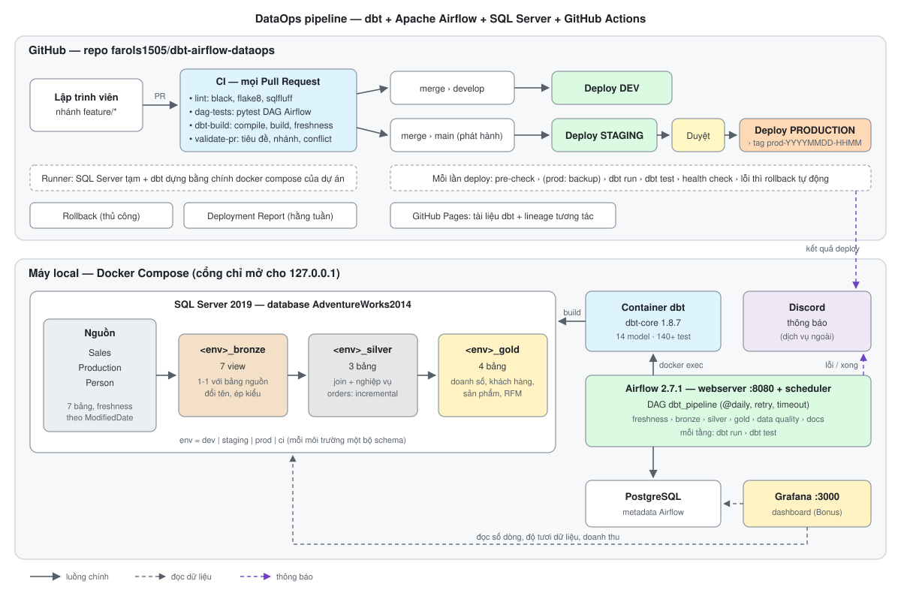
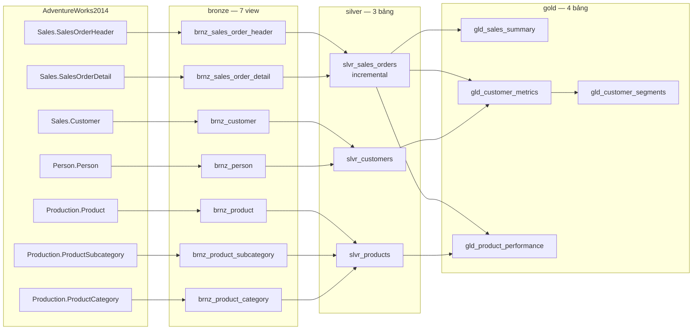
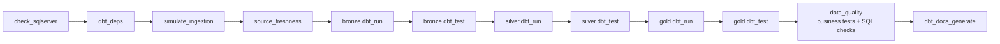
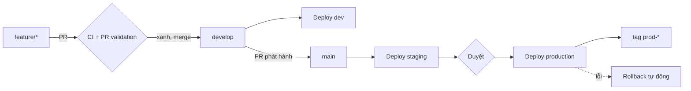

# Kiến trúc hệ thống

## 1. Thành phần

| Thành phần | Container / nơi chạy | Vai trò |
|---|---|---|
| **SQL Server 2019** | `sqlserver` (:1433) | Chứa dữ liệu nguồn AdventureWorks2014 **và** kết quả biến đổi (các schema `<env>_bronze/silver/gold`) |
| **dbt** | `dbt` | Biến đổi dữ liệu bằng SQL + Jinja; chạy test; sinh tài liệu |
| **Airflow** | `airflow-webserver` (:8080), `airflow-scheduler` | Lập lịch và điều phối dbt (`docker exec` vào container dbt) |
| **PostgreSQL** | `postgres` | Metadata của Airflow (lịch sử DAG run, task instance) |
| **Grafana** *(tùy chọn)* | `grafana` (:3000) | Dashboard giám sát, đọc PostgreSQL + SQL Server |
| **GitHub Actions** | Máy ảo của GitHub | CI cho Pull Request; CD tới dev/staging/production; báo cáo; GitHub Pages |
| **Discord** | Dịch vụ ngoài | Nhận thông báo từ Airflow và GitHub Actions |

## 2. Luồng dữ liệu (medallion)

| Tầng | Quy tắc | Materialization |
|---|---|---|
| **Bronze** | 1 model / 1 bảng nguồn. Đổi tên cột sang `snake_case`, ép kiểu, `trim` chuỗi, bỏ cột XML/rowguid. **Không join, không logic nghiệp vụ** | `view` |
| **Silver** | Join nhiều bronze, logic nghiệp vụ (loại khách hàng, phân khúc giá, kênh bán, trạng thái đơn) | `table`; `slvr_sales_orders` là `incremental` |
| **Gold** | Tổng hợp phục vụ báo cáo: theo ngày, theo khách hàng, theo sản phẩm, phân khúc RFM | `table` |

Lineage đầy đủ (kèm exposures): [`LINEAGE.md`](LINEAGE.md) và https://farols1505.github.io/dbt-airflow-dataops/

## 3. Luồng điều phối (Airflow)

## 4. Luồng CI/CD

## 5. Quyết định kỹ thuật chính

| # | Quyết định | Lý do |
|---|---|---|
| 1 | Môi trường = **schema riêng** (`dev_*`, `staging_*`, `prod_*`) trong cùng database | Không cần thêm server; dbt chuyển môi trường chỉ bằng `--target` |
| 2 | Macro `generate_schema_name` riêng | Adapter dbt-sqlserver mặc định bỏ qua tiền tố target → mọi môi trường ghi chung một schema |
| 3 | CI/CD dựng **SQL Server tạm bằng chính docker-compose.yml** | Máy ảo GitHub không truy cập được máy local; chạy giống hệt local |
| 4 | Mật khẩu qua biến môi trường (`.env`, GitHub Secrets); biến `DBT_ENV_SECRET_*` | Repo public; dbt tự che giá trị `DBT_ENV_SECRET_*` trong log |
| 5 | Airflow gọi dbt bằng `docker exec`, chọn model theo **thư mục** (`path:models/<tầng>`) | Không cài dbt vào image Airflow; thêm/đổi tên model không phải sửa DAG |
| 6 | `simulate_new_data` | AdventureWorks là dữ liệu tĩnh; mô phỏng lần nạp dữ liệu mới để freshness có ý nghĩa |
| 7 | Health check / backup / restore **duyệt mọi bảng trong schema** | Đổi tên model không làm hỏng quy trình deploy |
| 8 | Production phải **duyệt thủ công** + tag mỗi phiên bản | Kiểm soát thay đổi; lịch sử phiên bản; rollback theo tag |
| 9 | Grafana ở **file compose riêng** | Không sửa hạ tầng gốc; chỉ bật khi cần |

## 6. Bảo mật

- Repo public: không có mật khẩu trong code; `.env` nằm trong `.gitignore`; pre-commit `detect-private-key`.
- Cổng SQL Server, Airflow, Grafana chỉ mở cho `127.0.0.1`.
- Trên GitHub Actions: mật khẩu sinh ngẫu nhiên cho mỗi lần chạy (hoặc lấy từ Environment secrets) và được che trong log.
- Production chỉ deploy từ nhánh được bảo vệ, có người duyệt.
