# Lineage — luồng dữ liệu

> File này được **sinh tự động** bởi `scripts/generate_lineage_mermaid.py` từ dbt manifest. Không sửa tay.
>
> Bản tương tác (bấm vào từng model, xem cột, SQL, test): trang tài liệu dbt trên GitHub Pages — https://farols1505.github.io/dbt-airflow-dataops/

**7 bảng nguồn · 14 model · 3 exposure**

```mermaid
flowchart LR
  subgraph source_layer["Nguồn (AdventureWorks)"]
    source_dbt_sqlserver_project_person_Person["person.Person"]
    source_dbt_sqlserver_project_production_ProductCategory["production.ProductCategory"]
    source_dbt_sqlserver_project_production_ProductSubcategory["production.ProductSubcategory"]
    source_dbt_sqlserver_project_production_Product["production.Product"]
    source_dbt_sqlserver_project_sales_Customer["sales.Customer"]
    source_dbt_sqlserver_project_sales_SalesOrderDetail["sales.SalesOrderDetail"]
    source_dbt_sqlserver_project_sales_SalesOrderHeader["sales.SalesOrderHeader"]
  end
  style source_layer fill:#eceff1,stroke:#607d8b,color:#263238
  subgraph bronze_layer["Bronze"]
    model_dbt_sqlserver_project_brnz_customer["brnz_customer"]
    model_dbt_sqlserver_project_brnz_person["brnz_person"]
    model_dbt_sqlserver_project_brnz_product["brnz_product"]
    model_dbt_sqlserver_project_brnz_product_category["brnz_product_category"]
    model_dbt_sqlserver_project_brnz_product_subcategory["brnz_product_subcategory"]
    model_dbt_sqlserver_project_brnz_sales_order_detail["brnz_sales_order_detail"]
    model_dbt_sqlserver_project_brnz_sales_order_header["brnz_sales_order_header"]
  end
  style bronze_layer fill:#f3e0c7,stroke:#a0522d,color:#3e2723
  subgraph silver_layer["Silver"]
    model_dbt_sqlserver_project_slvr_customers["slvr_customers"]
    model_dbt_sqlserver_project_slvr_products["slvr_products"]
    model_dbt_sqlserver_project_slvr_sales_orders["slvr_sales_orders"]
  end
  style silver_layer fill:#e0e0e0,stroke:#757575,color:#212121
  subgraph gold_layer["Gold"]
    model_dbt_sqlserver_project_gld_customer_metrics["gld_customer_metrics"]
    model_dbt_sqlserver_project_gld_customer_segments["gld_customer_segments"]
    model_dbt_sqlserver_project_gld_product_performance["gld_product_performance"]
    model_dbt_sqlserver_project_gld_sales_summary["gld_sales_summary"]
  end
  style gold_layer fill:#fff3c4,stroke:#c9a227,color:#3e2723
  subgraph exposure_layer["Nơi sử dụng"]
    exposure_dbt_sqlserver_project_customer_segmentation_analysis(["Phân tích phân khúc khách hàng (RFM)"])
    exposure_dbt_sqlserver_project_grafana_dataops_dashboard(["Grafana — DataOps Pipeline"])
    exposure_dbt_sqlserver_project_product_sales_report(["Báo cáo hiệu quả sản phẩm"])
  end
  style exposure_layer fill:#d7ecff,stroke:#1e6bb8,color:#0d2b45
  model_dbt_sqlserver_project_brnz_customer --> model_dbt_sqlserver_project_slvr_customers
  model_dbt_sqlserver_project_brnz_person --> model_dbt_sqlserver_project_slvr_customers
  model_dbt_sqlserver_project_brnz_product --> model_dbt_sqlserver_project_slvr_products
  model_dbt_sqlserver_project_brnz_product_category --> model_dbt_sqlserver_project_slvr_products
  model_dbt_sqlserver_project_brnz_product_subcategory --> model_dbt_sqlserver_project_slvr_products
  model_dbt_sqlserver_project_brnz_sales_order_detail --> model_dbt_sqlserver_project_slvr_sales_orders
  model_dbt_sqlserver_project_brnz_sales_order_header --> model_dbt_sqlserver_project_slvr_sales_orders
  model_dbt_sqlserver_project_gld_customer_metrics --> exposure_dbt_sqlserver_project_customer_segmentation_analysis
  model_dbt_sqlserver_project_gld_customer_metrics --> model_dbt_sqlserver_project_gld_customer_segments
  model_dbt_sqlserver_project_gld_customer_segments --> exposure_dbt_sqlserver_project_customer_segmentation_analysis
  model_dbt_sqlserver_project_gld_customer_segments --> exposure_dbt_sqlserver_project_grafana_dataops_dashboard
  model_dbt_sqlserver_project_gld_product_performance --> exposure_dbt_sqlserver_project_product_sales_report
  model_dbt_sqlserver_project_gld_sales_summary --> exposure_dbt_sqlserver_project_grafana_dataops_dashboard
  model_dbt_sqlserver_project_slvr_customers --> model_dbt_sqlserver_project_gld_customer_metrics
  model_dbt_sqlserver_project_slvr_products --> model_dbt_sqlserver_project_gld_product_performance
  model_dbt_sqlserver_project_slvr_sales_orders --> model_dbt_sqlserver_project_gld_customer_metrics
  model_dbt_sqlserver_project_slvr_sales_orders --> model_dbt_sqlserver_project_gld_product_performance
  model_dbt_sqlserver_project_slvr_sales_orders --> model_dbt_sqlserver_project_gld_sales_summary
  source_dbt_sqlserver_project_person_Person --> model_dbt_sqlserver_project_brnz_person
  source_dbt_sqlserver_project_production_Product --> model_dbt_sqlserver_project_brnz_product
  source_dbt_sqlserver_project_production_ProductCategory --> model_dbt_sqlserver_project_brnz_product_category
  source_dbt_sqlserver_project_production_ProductSubcategory --> model_dbt_sqlserver_project_brnz_product_subcategory
  source_dbt_sqlserver_project_sales_Customer --> model_dbt_sqlserver_project_brnz_customer
  source_dbt_sqlserver_project_sales_SalesOrderDetail --> model_dbt_sqlserver_project_brnz_sales_order_detail
  source_dbt_sqlserver_project_sales_SalesOrderHeader --> model_dbt_sqlserver_project_brnz_sales_order_header
```

