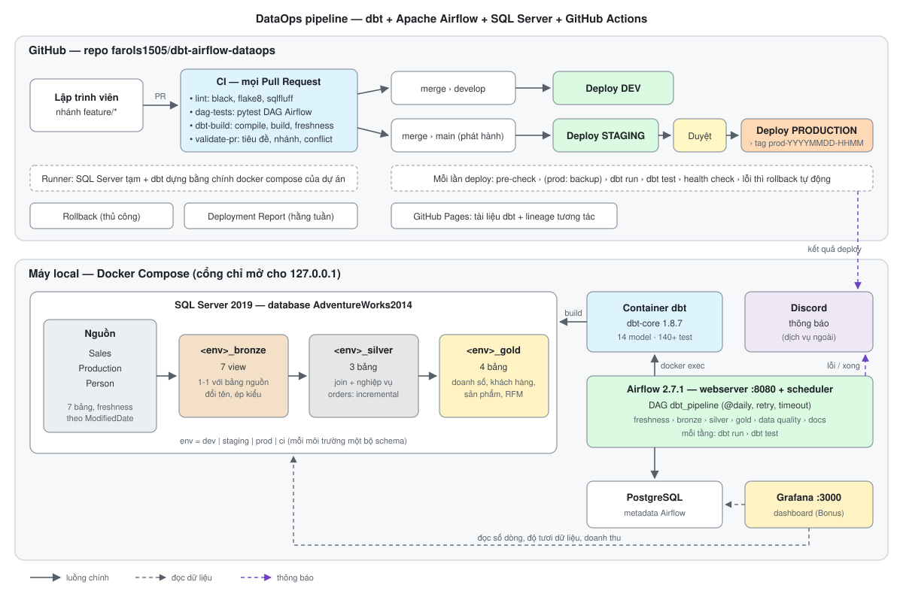

# 00 — TỔNG QUAN DỰ ÁN DATAOPS (LÀM MỘT MÌNH)
## dbt + Apache Airflow + SQL Server + GitHub Actions

> File này trả lời 3 câu hỏi: **(1) Phải làm những gì? (2) Làm theo cách nào? (3) Làm theo thứ tự nào?**
> Hướng dẫn chi tiết từng bước nằm ở các file `01_...` → `10_...` (xem [mục 9](#9-lộ-trình-các-file-hướng-dẫn)).
>
> Đề bài gốc: [`docs/course/4. DATAOPS_PROJECT_REQUIREMENTS.md`](../docs/course/4.%20DATAOPS_PROJECT_REQUIREMENTS.md) (trước file 08: ở thư mục gốc của repo).

---

## Mục lục

1. [Dự án này là gì?](#1-dự-án-này-là-gì)
2. [Mục tiêu điểm và thứ tự ưu tiên](#2-mục-tiêu-điểm-và-thứ-tự-ưu-tiên)
3. [Kiến trúc sau khi hoàn thành](#3-kiến-trúc-sau-khi-hoàn-thành)
4. [Cách dùng bộ hướng dẫn: file đã được tạo sẵn](#4-cách-dùng-bộ-hướng-dẫn-file-đã-được-tạo-sẵn)
5. [Các quyết định kỹ thuật đã chốt](#5-các-quyết-định-kỹ-thuật-đã-chốt)
6. [Danh sách công việc theo phần chấm điểm](#6-danh-sách-công-việc-theo-phần-chấm-điểm)
7. [Cấu trúc thư mục](#7-cấu-trúc-thư-mục)
8. [Quy trình làm việc với Git](#8-quy-trình-làm-việc-với-git)
9. [Lộ trình các file hướng dẫn](#9-lộ-trình-các-file-hướng-dẫn)
10. [Kế hoạch 3 tuần](#10-kế-hoạch-3-tuần)
11. [Checklist nộp bài + rủi ro](#11-checklist-nộp-bài--rủi-ro)

---

## 1. Dự án này là gì?

Xây dựng một **pipeline dữ liệu tự động** theo tinh thần **DataOps** (áp dụng DevOps vào dữ liệu):

- **Dữ liệu nguồn:** database mẫu **AdventureWorks2014** (công ty bán xe đạp) chạy trên **SQL Server**.
- **Biến đổi dữ liệu:** **dbt**, 3 tầng: **bronze** (1-1 với bảng nguồn, làm sạch nhẹ) → **silver** (join + logic nghiệp vụ) → **gold** (bảng tổng hợp cho báo cáo).
- **Điều phối:** **Airflow** chạy dbt hằng ngày theo từng tầng, retry khi lỗi, kiểm tra chất lượng, gửi cảnh báo.
- **Tự động hóa:** **GitHub Actions**: CI cho mọi Pull Request; CD tự deploy qua **dev → staging → production** khi merge; rollback.
- **Giám sát:** Grafana + Discord; lineage tương tác trên GitHub Pages.

**Đề bài:** 3 tuần · 100 điểm · **qua môn = 60 điểm (MVP)** · bonus tối đa +15. Đề bài dành cho nhóm 3 người; ở đây **một người làm toàn bộ**.

---

## 2. Mục tiêu điểm và thứ tự ưu tiên

| Phần | Điểm | File hướng dẫn |
|---|---|---|
| 1. dbt Data Models | 25 | `04` |
| 2. Automated Testing | 20 | `04` |
| 3. Airflow Orchestration | 15 | `05` |
| 4. CI/CD & Deployment Automation | **35** | `03` (CI + deploy), `06` (môi trường), `07` (rollback + giám sát deploy) |
| 5. Documentation & Presentation | 5 | `03` (README), `08` |
| **Bonus 4** — dev/staging/prod | +5 | `06` |
| **Bonus 1** — Grafana | +5 | `09` |
| **Bonus 2** — Lineage | +5 | `10` |

> Không làm slide và video demo (giáo viên không yêu cầu). Buổi thuyết trình là **demo trực tiếp**.

### Ba mốc điểm

| Mốc | Đạt sau file | Điểm |
|---|---|---|
| 🥉 **MVP** | `03` | **~60** (model + test + DAG gốc vẫn chạy được; thêm CI, deploy, README) |
| 🥈 **Đủ điểm** | `08` | **~100** |
| 🥇 **Bonus** | `09`, `10` (bonus 4 nằm ở `06`) | **+15** |

> **Nguyên tắc vàng:** bonus không bù phần bắt buộc bị thiếu. Làm theo thứ tự **MVP → 100 → bonus**. CI/CD được làm **trước** (file 03) để mọi thay đổi sau đó đều được kiểm tra tự động.

---

## 3. Kiến trúc sau khi hoàn thành



Chi tiết: [`docs/ARCHITECTURE.md`](../docs/ARCHITECTURE.md).

---

## 4. Cách dùng bộ hướng dẫn: file đã được tạo sẵn

**Toàn bộ file của dự án (cho file 03 → 10) đã được tạo sẵn trong thư mục dự án** nhưng **chưa commit**. Mỗi file hướng dẫn:

1. Liệt kê các file của bước đó: **nội dung** và **mục đích** (đáp ứng yêu cầu nào của đề bài).
2. Giải thích các phần quan trọng.
3. Hướng dẫn **chạy thử / kiểm tra** trên máy.
4. Hướng dẫn **commit từng phần** (lệnh `git add <đường dẫn cụ thể>` + commit message), mở Pull Request, merge, phát hành.

⚠️ **Quy tắc quan trọng:** vì thư mục chứa sẵn file của các bước sau, **luôn `git add` đúng đường dẫn được liệt kê**, không dùng `git add -A` hay `git add .` không kèm đường dẫn. Trong lúc làm bước N, `git status` vẫn hiện file của bước N+1... là bình thường.

Đã kiểm tra trước khi giao (2026-11-13, **trên hệ thống thật** của máy bạn):

| Hạng mục | Kết quả |
|---|---|
| Lint toàn bộ: pre-commit (black, flake8, sqlfluff, YAML...), actionlint + shellcheck cho workflow, JSON schema của GitHub Actions | ✅ sạch |
| dbt trên SQL Server thật (target dev): `dbt build --full-refresh` | ✅ `PASS=157 ERROR=0` |
| Freshness: trước mô phỏng → `ERROR STALE` ×7; sau `simulate_new_data` → `PASS` ×7; trigger AdventureWorks được bật lại | ✅ |
| Incremental: chạy lại chỉ xử lý dữ liệu mới, không trùng dòng; benchmark (full 1.15 s / incremental 0.19–0.28 s) | ✅ |
| Macro vận hành: `health_check` (phát hiện bảng rỗng → mã lỗi), `backup_layers` → `restore_layers`, `drop_orphan_relations` | ✅ |
| Diễn tập test thất bại (`valid_date_range`) rồi khôi phục | ✅ |
| Airflow 2.7.1 thật: 18 test pytest; DAG chạy **trọn vẹn 14 task** qua scheduler; diễn tập lỗi → retry cứu được | ✅ |
| Thông báo: payload Discord của 3 callback Airflow + `notify.py` (bắt bằng HTTP server giả) | ✅ |
| CI mô phỏng trên **stack Docker riêng** (database mới hoàn toàn, mật khẩu ngẫu nhiên): `create_env` → build → `up --wait` → restore → `dbt-build` (target `ci`, PASS=157, freshness, docs) → tóm tắt | ✅ |
| Deploy production mô phỏng: validation → dựng lại bản cũ từ tag → backup → deploy → **lỗi giả → rollback** về đúng bản cũ → deploy lại thành công → test → health check → tag (cục bộ) → thông báo | ✅ |
| Grafana 13.2.4: provisioning, 2 datasource *Connection OK*, **11/11 panel** truy vấn có dữ liệu | ✅ |

**Chưa chạy được ở đây** (cần push lên GitHub, mà bạn yêu cầu không commit): các workflow chạy thật trên GitHub Actions, GitHub Environments/duyệt, GitHub Pages. Các file 03, 06, 07, 10 hướng dẫn kiểm tra những phần này.

---

## 5. Các quyết định kỹ thuật đã chốt

| # | Vấn đề | Quyết định |
|---|---|---|
| D1 | Phiên bản | dbt-core/dbt-sqlserver **1.8.7**, Airflow **2.7.1** (Python 3.9), SQL Server **2019**, Grafana **13.2.4** |
| D2 | SQL Server trên GitHub Actions | Dựng SQL Server **tạm** bằng chính `docker-compose.yml` (composite action `setup-dbt-stack`) + `scripts/init_sqlserver.sh` |
| D3 | Môi trường | Cùng database, **khác schema**: `dev_*`, `staging_*`, `prod_*`, `ci_*`; macro `generate_schema_name` (adapter mặc định bỏ qua tiền tố target) |
| D4 | Bí mật | `.env` (không commit) + GitHub Secrets; biến `DBT_ENV_SECRET_*` được dbt tự che trong log; CI sinh mật khẩu ngẫu nhiên |
| D5 | Thông báo | Discord webhook cho cả Airflow và GitHub Actions |
| D6 | Rollback | Tag `prod-YYYYMMDD-HHMM` mỗi lần deploy production; backup silver/gold trước deploy → lỗi thì restore tự động; workflow rollback thủ công theo tag |
| D7 | Bảo vệ nhánh | Bắt buộc PR, **0 người duyệt** (làm một mình), **bắt buộc 4 check CI**; production cần duyệt qua GitHub Environments |
| D8 | Lint | black + flake8 (Python), sqlfluff tsql (SQL, chỉ `dbt/models`); cùng cấu hình ở pre-commit và CI |
| D9 | Chọn model theo tầng | `--select path:models/<tầng>` (không phụ thuộc tên model) |
| D10 | Biến môi trường container | Khai báo một lần trong `docker-compose.yml` (file 02) |
| D11 | Health check / backup / restore | Duyệt **mọi bảng trong schema**, không liệt kê tên cố định |
| D12 | Database của CD là tạm thời | Trước khi deploy production: **dựng lại phiên bản đang chạy** (tag mới nhất) để backup/rollback có ý nghĩa; deploy dùng `--full-refresh` |
| D13 | Dữ liệu tĩnh (2014) | Macro `simulate_new_data` mô phỏng lần nạp dữ liệu mới → freshness có ý nghĩa |
| D14 | Grafana | File compose riêng `docker-compose.monitoring.yml`, cấu hình dạng code |

---

## 6. Danh sách công việc theo phần chấm điểm

| Yêu cầu đề bài | Cách đáp ứng | File |
|---|---|---|
| **Bronze**: ≥ 3 nguồn, làm sạch, freshness, mô tả cột | 7 view 1-1 với nguồn, freshness 7 bảng, mô tả 100% cột | 04 |
| **Silver**: ≥ 2 model, join, nghiệp vụ, test | 3 model; `slvr_sales_orders` incremental | 04 |
| **Gold**: ≥ 2 model, aggregation, hiệu năng | 4 model (gồm RFM), columnstore, incremental + index ở silver, đo hiệu năng | 04 |
| Schema tests | `not_null`, `unique`, `relationships`, `accepted_values` | 04 |
| ≥ 3 custom tests | 4 generic + 3 singular | 04 |
| Source freshness + độ trễ kỳ vọng | warn 24h, error 48h, `meta.expected_latency` | 04 |
| DAG đúng thứ tự, lịch, retry, quality checks, thông báo, tài liệu | `dbt_pipeline` 14 task | 05 |
| CI: compile, test trên PR, flake8/black, sqlfluff, PR validation, sinh docs | `ci.yml`, `pr-validation.yml` | 03 |
| CD cơ bản: merge → deps/run/test, trạng thái, log | `deploy.yml` + `_deploy.yml` | 03 |
| CD nâng cao: dev/prod, thông báo, badges, rollback, pre/post check | Environments + duyệt + Discord + tag | 06, 07 |
| Tài liệu deploy, runbook, lịch sử, tỉ lệ thành công, rollback | `DEPLOYMENT_RUNBOOK.md`, `ROLLBACK.md`, `deploy-report.yml` | 07 |
| README, kiến trúc + sơ đồ, setup guide, troubleshooting, demo 15 phút | `README.md`, `docs/*` | 03, 08 |

---

## 7. Cấu trúc thư mục

```
dbt_airflow_project/
├── .github/
│   ├── actions/setup-dbt-stack/action.yml   # 03
│   ├── workflows/
│   │   ├── ci.yml, pr-validation.yml        # 03
│   │   ├── deploy.yml, _deploy.yml          # 03
│   │   ├── rollback.yml, deploy-report.yml  # 07
│   │   └── docs-pages.yml                   # 10
│   └── pull_request_template.md             # 02
├── airflow/dags/
│   ├── dbt_dag.py                           # 05
│   ├── dataops_utils/notifications.py       # 05
│   └── .airflowignore                       # 05
├── dbt/
│   ├── models/bronze|silver|gold/           # 04
│   ├── models/docs.md                       # 04
│   ├── models/exposures.yml                 # 10
│   ├── tests/generic/, tests/assert_*.sql   # 04
│   ├── macros/generate_schema_name.sql      # 02
│   ├── macros/ops/                          # 03 (health check, backup, restore...), 04 (simulate_new_data)
│   └── profiles.yml, dbt_project.yml        # 02, 04
├── monitoring/grafana/                      # 09
├── scripts/
│   ├── init_sqlserver.sh                    # 02
│   ├── ci/                                  # 03, 07
│   ├── benchmark_incremental.sh             # 04
│   └── generate_lineage_mermaid.py          # 10
├── tests/                                   # 05 (pytest cho DAG)
├── docs/                                    # 04, 06, 07, 08, 09, 10
│   └── course/                              # 08 (tài liệu gốc của môn)
├── project/                                 # các file hướng dẫn này
├── docker-compose.yml                       # 02
├── docker-compose.monitoring.yml            # 09
└── README.md                                # 03
```

---

## 8. Quy trình làm việc với Git

```
develop ──┬────────────────────────────────────────────┬──► (phát hành) ──► main
          │                                            ▲
          └─► feature/ten-viec ──► Pull Request ──► CI xanh ──► Squash and merge
```

1. Nhánh mới từ `develop`: `git switch develop && git pull && git switch -c feature/...`.
2. Commit theo Conventional Commits (pre-commit chặn nếu sai), `git add` **đúng đường dẫn**.
3. `git push -u origin <nhánh>` → `gh pr create --base develop --title "..." --body "..."`.
4. `gh pr checks --watch` → 4 check xanh → `gh pr merge --squash --delete-branch`.
5. **Phát hành:** `gh pr create --base main --head develop --title "chore(release): ..."` → `gh pr merge --merge` (merge commit) → duyệt production.

| Quy ước | Giá trị |
|---|---|
| Nhánh | `feature/`, `fix/`, `docs/`, `ci/`, `chore/`, `refactor/`, `test/`, `perf/`, `build/`, `style/`, `hotfix/` |
| Model | `brnz_<bảng>`, `slvr_<thực thể>`, `gld_<chủ đề>`, cột `snake_case` |
| Target dbt | `dev`, `staging`, `prod`, `ci` |
| Tag phát hành | `prod-YYYYMMDD-HHMM` (rollback: thêm `-rollback`) |
| Required checks | `lint`, `dag-tests`, `dbt-build`, `validate-pr` |

---

## 9. Lộ trình các file hướng dẫn

| File | Nội dung | Điểm | Thời gian | Mốc |
|---|---|---|---|---|
| `01_CHUAN_BI_MOI_TRUONG.md` | Công cụ, Docker, cài hệ thống từ repo | — | ✅ xong | |
| `02_GIT_GITHUB_VA_NEN_TANG.md` | Repo, nhánh, `.env`, compose, pre-commit | — | ✅ xong | |
| `03_CI_VA_DEPLOY_CO_BAN.md` | Hoàn tất PR #1; CI; kiểm tra PR; deploy dev/staging/prod; macro vận hành; README; bật CI bắt buộc; phát hành đầu tiên | 4A + 4B cơ bản + 5 | 4–6 giờ | 🥉 **MVP** |
| `04_DBT_MODELS_VA_TESTING.md` | Bronze/silver/gold mới, sửa lỗi logic, RFM, incremental, 143 test, freshness, tài liệu | 1 + 2 | 5–7 giờ | |
| `05_AIRFLOW_DAG.md` | DAG theo tầng, retry, SQL checks, Discord, pytest | 3 | 3–4 giờ | |
| `06_CD_VA_MULTI_ENV.md` | GitHub Environments, duyệt production, secrets, phát hành có duyệt | 4B nâng cao + Bonus 4 | 2–3 giờ | |
| `07_ROLLBACK_VA_GIAM_SAT_DEPLOY.md` | Rollback thủ công, báo cáo deploy, runbook; diễn tập rollback | 4C | 2–3 giờ | |
| `08_TAI_LIEU_VA_DEMO.md` | Kiến trúc + sơ đồ, setup guide, troubleshooting, kịch bản demo, dọn repo | 5 | 3–4 giờ | 🥈 **100** |
| `09_GRAFANA_MONITORING.md` | Grafana dạng code | Bonus 1 | 1–2 giờ | 🥇 |
| `10_LINEAGE_GITHUB_PAGES.md` | Exposures, lineage Mermaid, GitHub Pages | Bonus 2 | 1–2 giờ | 🥇 |

**Tổng còn lại:** khoảng 25–35 giờ.

---

## 10. Kế hoạch 3 tuần

| Tuần | Việc | Mốc cuối tuần |
|---|---|---|
| **Tuần 1** | `03` → `04` | ✅ Qua môn; model + test hoàn chỉnh |
| **Tuần 2** | `05` → `06` → `07` | ✅ Phần 3, 4 hoàn chỉnh |
| **Tuần 3** | `08` → `09` → `10` → tập demo 2 lần | ✅ ~100 + bonus |

**Nếu thiếu thời gian**, bỏ theo thứ tự: `10` → `09` → phần staging trong `06` (vẫn giữ dev + prod). **Không bao giờ bỏ:** CI, deploy, test, DAG, README.

---

## 11. Checklist nộp bài + rủi ro

Checklist nộp bài đầy đủ: [`08_TAI_LIEU_VA_DEMO.md`](08_TAI_LIEU_VA_DEMO.md#checklist-nộp-bài). Kịch bản demo: [`docs/DEMO_SCRIPT.md`](../docs/DEMO_SCRIPT.md).

| Rủi ro | Phòng tránh |
|---|---|
| Không đủ thời gian (một người làm việc của ba người) | Đi đúng thứ tự mốc; MVP xong tuần 1 |
| Lỡ commit file của bước sau | Luôn `git add <đường dẫn>`; kiểm tra `git status` trước khi commit |
| Workflow lỗi trên GitHub (các bước đã chạy thử trên stack Docker riêng, nhưng chưa chạy trên chính GitHub Actions) | Đọc **Summary** + log; mục *Lỗi thường gặp* của từng file; sửa qua nhánh `fix/...` |
| Lộ mật khẩu/webhook (repo public) | `.env` bị Git bỏ qua; pre-commit `detect-private-key`; chỉ dùng GitHub Secrets |
| Máy hỏng trước buổi demo | Push thường xuyên; `docs/SETUP_GUIDE.md`; ảnh chụp dự phòng |
| Liêm chính học thuật | Hiểu mọi file đã nộp; khai báo dùng AI trong README |
