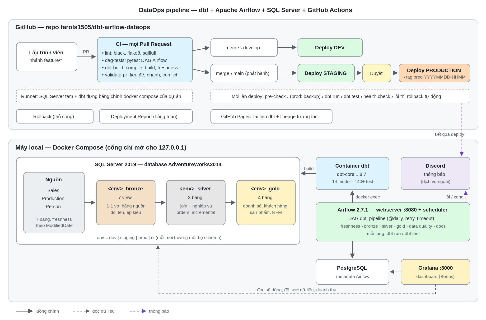
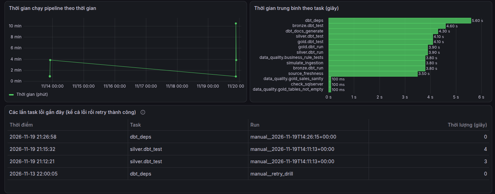

**ĐẠI HỌC QUỐC GIA THÀNH PHỐ HỒ CHÍ MINH**

**TRƯỜNG ĐẠI HỌC KHOA HỌC TỰ NHIÊN**

**BÁO CÁO ĐỒ ÁN**

**XÂY DỰNG DATAOPS PIPELINE**

*dbt + Apache Airflow + SQL Server + GitHub Actions*

Môn học: **Advanced DevOps — DataOps**

| Thông tin | Nội dung |
|--------------------------------|-----------------------------------------------------------|
| Sinh viên thực hiện | [Họ và tên] |
| Mã số sinh viên | [MSSV] |
| Giảng viên hướng dẫn | [Tên giảng viên] |
| GitHub | farols1505 |
| Mã nguồn | https://github.com/farols1505/dbt-airflow-dataops |

*Thành phố Hồ Chí Minh, tháng 11 năm 2026*

---

# 1. Giới thiệu

## 1.1. Bối cảnh và mục tiêu

Trong các hệ thống dữ liệu, mô hình và báo cáo thường được cập nhật thủ công: sửa câu SQL, chạy lại bằng tay, kiểm tra bằng mắt. Cách làm này chậm, dễ sai và khó truy vết. **DataOps** áp dụng các nguyên tắc DevOps vào kỹ thuật dữ liệu: quản lý phiên bản, kiểm thử tự động, tích hợp và triển khai liên tục (CI/CD), giám sát và phản hồi nhanh.

Đồ án xây dựng một pipeline dữ liệu hoàn chỉnh theo tinh thần đó: biến đổi dữ liệu bán hàng **AdventureWorks2014** trên **SQL Server** bằng **dbt** theo kiến trúc medallion (bronze → silver → gold), điều phối hằng ngày bằng **Apache Airflow**, kiểm thử và triển khai tự động bằng **GitHub Actions** qua ba môi trường **dev → staging → production**, có thông báo, giám sát và khả năng rollback.

## 1.2. Kết quả chính

*Bảng 1. Tóm tắt kết quả đồ án*

| Chỉ số | Giá trị |
|-------------------------|-----------------------------------------------------------------|
| Mô hình dbt | 14 model: 7 bronze (view) · 3 silver (table, 1 incremental) · 4 gold (table) |
| Kiểm thử dữ liệu | 143 test; `dbt build --full-refresh` đạt **157/157** (14 model + 143 test) |
| Airflow | DAG `dbt_pipeline`: 14 task, chạy `@daily`, retry tăng dần; 18 test pytest cho DAG |
| GitHub Actions | 7 workflow (CI, kiểm tra PR, deploy, deploy dùng lại, rollback, báo cáo, GitHub Pages) + 1 composite action |
| Môi trường | dev · staging · production (duyệt thủ công) + môi trường `ci` cho Pull Request |
| Quy trình phát triển | 17 Pull Request đã merge; nhánh `main`/`develop` được bảo vệ; Conventional Commits |
| Lịch sử production | 8 tag `prod-*` (gồm 1 lần rollback thủ công) |
| Bonus | Dashboard Grafana · Lineage tương tác trên GitHub Pages · 3 môi trường dev/staging/prod |

## 1.3. Công nghệ sử dụng

*Bảng 2. Công nghệ sử dụng*

| Vai trò | Công nghệ | Ghi chú |
|--------------------|------------------------------------|----------------------------------|
| Cơ sở dữ liệu | SQL Server 2019 + AdventureWorks2014 | Dữ liệu nguồn và kết quả biến đổi |
| Biến đổi dữ liệu | dbt-core 1.8.7, dbt-sqlserver 1.8.7, dbt_utils | SQL + Jinja, test, tài liệu, lineage |
| Điều phối | Apache Airflow 2.7.1 (+ PostgreSQL metadata) | Lập lịch, retry, kiểm tra chất lượng, thông báo |
| Hạ tầng | Docker, Docker Compose | 5 container (+ Grafana tùy chọn) |
| CI/CD | GitHub Actions, GitHub Environments, GitHub Pages | Kiểm thử PR, deploy theo môi trường, tài liệu |
| Chất lượng mã | pre-commit, black, flake8, sqlfluff, SonarCloud | Chạy cả trên máy và trên CI |
| Giám sát, thông báo | Grafana 13, Discord webhook | Dashboard dạng code; thông báo Airflow và deploy |
| Ngôn ngữ | SQL, Python, YAML, Bash |  |

## 1.4. Hình thức thực hiện

Đề bài được thiết kế cho nhóm 3 sinh viên; đồ án này do **một sinh viên thực hiện toàn bộ** (thiết kế, cài đặt, kiểm thử, tài liệu). Mã nguồn công khai tại https://github.com/farols1505/dbt-airflow-dataops. Việc sử dụng công cụ AI được khai báo ở Mục 12 theo quy định của đề bài.

# 2. Kiến trúc hệ thống

## 2.1. Sơ đồ tổng thể

Hệ thống gồm hai khối: **máy local** chạy bằng Docker Compose (SQL Server, dbt, Airflow, PostgreSQL, Grafana) và **GitHub** (CI/CD, môi trường triển khai, trang tài liệu). Thông báo từ cả hai khối được gửi về Discord.



*Hình 1. Kiến trúc tổng thể của DataOps pipeline*

## 2.2. Thành phần

*Bảng 3. Các thành phần của hệ thống*

| Thành phần | Nơi chạy | Vai trò |
|------------------|-----------------------------|-------------------------------------------|
| SQL Server 2019 | Container `sqlserver` (:1433) | Chứa dữ liệu nguồn và các schema kết quả `<env>_bronze/silver/gold` |
| dbt | Container `dbt` | Biến đổi dữ liệu, chạy test, sinh tài liệu và lineage |
| Airflow | `airflow-webserver` (:8080), `airflow-scheduler` | Lập lịch và điều phối dbt bằng `docker exec` |
| PostgreSQL | Container `postgres` | Metadata của Airflow (lịch sử DAG run, task) |
| Grafana (tùy chọn) | Container `grafana` (:3000) | Dashboard giám sát pipeline và dữ liệu |
| GitHub Actions | Máy ảo GitHub | CI cho Pull Request; CD tới dev/staging/production; báo cáo; GitHub Pages |
| Discord | Dịch vụ ngoài | Nhận thông báo từ Airflow và GitHub Actions |

## 2.3. Quyết định kỹ thuật chính

*Bảng 4. Các quyết định kỹ thuật chính*

| # | Quyết định | Lý do |
|-----|------------------------------------------|-------------------------------------------|
| 1 | Mỗi môi trường là **một bộ schema riêng** (`dev_*`, `staging_*`, `prod_*`) trong cùng database | Không cần thêm server; dbt đổi môi trường chỉ bằng `--target` |
| 2 | Macro `generate_schema_name` riêng | Adapter dbt-sqlserver mặc định bỏ tiền tố target, khiến mọi môi trường ghi chung một schema |
| 3 | CI/CD dựng **SQL Server tạm bằng chính docker-compose.yml** của dự án | Máy ảo GitHub không truy cập được máy local; môi trường kiểm thử giống hệt local |
| 4 | Mật khẩu qua `.env` và GitHub Secrets; biến `DBT_ENV_SECRET_*` | Repo công khai; dbt tự che giá trị `DBT_ENV_SECRET_*` trong log |
| 5 | Airflow gọi dbt bằng `docker exec`, chọn model theo thư mục tầng | Không cài dbt vào image Airflow; thêm model không phải sửa DAG |
| 6 | Macro `simulate_new_data` mô phỏng lần nạp dữ liệu | AdventureWorks là dữ liệu tĩnh (2011–2014), freshness luôn lỗi nếu không mô phỏng |
| 7 | Production phải **duyệt thủ công** và mỗi phiên bản được gắn tag | Kiểm soát thay đổi, có lịch sử phiên bản, rollback theo tag |
| 8 | Grafana ở file compose riêng, cấu hình dạng code | Không sửa hạ tầng gốc; dashboard được quản lý phiên bản như mã nguồn |

## 2.4. Bảo mật

- Không có mật khẩu trong mã nguồn; `.env` nằm trong `.gitignore`; hook `detect-private-key` chặn commit khóa bí mật.
- Cổng SQL Server, Airflow, Grafana chỉ mở cho `127.0.0.1`.
- Trên GitHub Actions, mật khẩu được sinh ngẫu nhiên cho mỗi lần chạy hoặc lấy từ Environment secrets, và luôn được che trong log.
- Workflow dùng quyền tối thiểu: mặc định chỉ đọc, quyền ghi cấp riêng cho đúng job cần; thư viện cài từ phiên bản đã khóa, chỉ dùng gói nhị phân (đạt Quality Gate của SonarCloud).

# 3. Phần 1 — Mô hình dữ liệu dbt

## 3.1. Nguồn dữ liệu

Ba source được khai báo theo schema của AdventureWorks trong `dbt/models/bronze/_sources.yml`, tổng cộng **7 bảng nguồn**:

*Bảng 5. Các bảng nguồn*

| Source | Schema | Bảng |
|------------------|------------------|------------------------------------------------------|
| `sales` | Sales | SalesOrderHeader, SalesOrderDetail, Customer |
| `production` | Production | Product, ProductSubcategory, ProductCategory |
| `person` | Person | Person |

## 3.2. Tầng bronze — chuẩn hóa

Mỗi model bronze tương ứng **đúng một bảng nguồn** (7 model `brnz_*`), vật chất hóa dạng **view**. Bronze chỉ làm sạch và chuẩn hóa, **không join và không chứa logic nghiệp vụ**:

- Đổi tên cột sang `snake_case`, ép kiểu rõ ràng (tiền tệ `money` → `decimal(19, 4)`, ngày → `date`).
- `trim` chuỗi, chuỗi rỗng → `NULL` (`nullif(trim(x), '')`), cắt khoảng trắng của cột `nchar` như `ProductLine`.
- Bỏ cột XML và `rowguid`; mọi cột đều có mô tả trong `_bronze__models.yml`.

## 3.3. Tầng silver — logic nghiệp vụ

*Bảng 6. Các model silver*

| Model | Join | Logic nghiệp vụ |
|----------------------|-----------------------|---------------------------------------------|
| `slvr_customers` | customer + person | `customer_type` (Individual/Store), `full_name` (cửa hàng không có người liên hệ → `Store #<id>`) |
| `slvr_products` | product + subcategory + category | `price_tier` (Not for sale / Budget / Mid-range / Premium), `is_active`, giá trị mặc định cho danh mục thiếu |
| `slvr_sales_orders` | order detail + order header | `order_status_name`, `order_channel` (Online/Offline), `gross_amount`, `discount_amount`, `has_discount`, `days_to_ship` |

`slvr_sales_orders` là bảng lớn nhất (~121 nghìn dòng) nên được cấu hình **incremental** (`delete+insert` theo `order_detail_id`): lần chạy sau chỉ xử lý các dòng có `modified_at` mới hơn dữ liệu đã có; hai **nonclustered index** trên `customer_id`, `product_id` được tạo bằng `post_hook`.

## 3.4. Tầng gold — dữ liệu sẵn sàng phân tích

*Bảng 7. Các model gold*

| Model | Mức chi tiết | Nội dung chính |
|-------------------------|------------------|-----------------------------------------------|
| `gld_sales_summary` | 1 dòng / ngày | Số đơn, số khách, doanh thu, giảm giá, số đơn online/offline, giá trị đơn trung bình |
| `gld_customer_metrics` | 1 dòng / khách hàng | Số đơn, doanh thu, giá trị đơn trung bình, lần mua đầu/cuối, số ngày từ lần mua cuối |
| `gld_product_performance` | 1 dòng / sản phẩm | Số lượng bán, doanh thu, lợi nhuận, `profit_margin_pct` (NULL khi chưa có doanh thu, tránh chia cho 0) |
| `gld_customer_segments` | 1 dòng / khách đã mua | Phân khúc **RFM**: điểm R/F/M (1–4, `NTILE(4)`) → Champions, Loyal, Promising, Needs Attention, At Risk, Hibernating |

## 3.5. Sửa lỗi so với mô hình mẫu

Mô hình mẫu ban đầu của repository có một số lỗi về phân tầng và logic; tất cả đã được sửa và có test bảo vệ:

*Bảng 8. Các lỗi đã sửa trong mô hình mẫu*

| Vấn đề ở mô hình mẫu | Cách sửa |
|---------------------------------------------|---------------------------------------------|
| Bronze **join** nhiều bảng (sai nguyên tắc phân tầng) | Bronze 1-1 với bảng nguồn; join chuyển lên silver |
| `avg_order_value` tính trung bình theo **dòng sản phẩm** | = doanh thu / số **đơn hàng** |
| `online_orders`, `offline_orders`, `orders_with_discount` đếm **dòng** | Đếm `distinct sales_order_id` |
| Hai file source trùng nhau, một source trỏ sai schema; file mẫu thừa | Gộp thành một `_sources.yml`; xóa file thừa |
| Chỉ có `not_null`/`unique`, thiếu mô tả cột, không có freshness | 143 test, mô tả mọi cột, freshness cho cả 7 bảng nguồn |

## 3.6. Tối ưu hiệu năng

- **View** cho bronze (không tốn dung lượng, luôn mới); **table** cho silver/gold (dashboard đọc bảng đã tính sẵn).
- dbt-sqlserver tạo **clustered columnstore index** cho mọi bảng → truy vấn tổng hợp ở gold nhanh.
- **Incremental** + **nonclustered index** cho `slvr_sales_orders`; DAG chạy theo tầng nên lỗi ở tầng nào dừng ở tầng đó.

*Bảng 9. Đo hiệu năng incremental (script scripts/benchmark_incremental.sh)*

| Trường hợp (`slvr_sales_orders`, 121 317 dòng) | Thời gian |
|---------------------------------------------------------------|---------------------------|
| Full refresh | 1,15 giây |
| Incremental — không có dữ liệu mới | 0,28 giây |
| Incremental — sau khi có 20 đơn hàng mới (50 dòng) | 0,19 giây |

Incremental nhanh hơn full refresh khoảng **4–6 lần** ngay với bộ dữ liệu nhỏ; vì thời gian incremental chỉ phụ thuộc lượng dữ liệu **mới**, chênh lệch càng lớn khi dữ liệu tăng.

## 3.7. Tài liệu và lineage

Mọi model và cột có mô tả trong các file YAML theo tầng; `dbt/models/exposures.yml` khai báo các nơi sử dụng dữ liệu (dashboard, báo cáo) để lineage kéo dài tới người dùng cuối. Tài liệu dbt kèm **lineage tương tác** được tự động đăng lên GitHub Pages (https://farols1505.github.io/dbt-airflow-dataops/); `docs/LINEAGE.md` chứa sơ đồ Mermaid sinh tự động từ manifest để xem ngay trên GitHub.

# 4. Phần 2 — Kiểm thử tự động

## 4.1. Kiểm thử chạy ở đâu

*Bảng 10. Các nơi chạy kiểm thử*

| Nơi chạy | Khi nào | Lệnh |
|-----------------------|--------------------|-----------------------------------------------|
| Máy local | Khi phát triển | `dbt build` |
| CI — job `dbt-build` | Mọi Pull Request | `dbt build --target ci` trên SQL Server tạm |
| CD — `_deploy.yml` | Mỗi lần deploy | `dbt test --target <env>`; lỗi ở production → rollback tự động |
| Airflow — `dbt_pipeline` | Hằng ngày | `dbt test` sau mỗi tầng + test nghiệp vụ cuối pipeline |

## 4.2. Thống kê test

*Bảng 11. Phân loại 143 test dbt*

| Loại test | Số lượng | Ví dụ |
|----------------------------------|-----------|---------------------------------------------|
| `not_null` | 50 | Khóa chính của mọi model và bảng nguồn |
| `unique` | 26 | `brnz_customer.customer_id`, `gld_sales_summary.order_date` |
| `accepted_values` | 19 | `order_status` ∈ 1..6, `order_channel` ∈ {Online, Offline}, `customer_segment` |
| `relationships` | 11 | `slvr_sales_orders.customer_id` → `slvr_customers` |
| `dbt_utils` (khóa ghép, biểu thức, khoảng giá trị) | 4 | `online_orders + offline_orders = total_orders`; `profit_margin_pct ≤ 100` |
| `positive_value` (tự viết) | 19 | Số lượng, đơn giá, doanh thu > 0 |
| `date_not_before` (tự viết) | 5 | `ship_date ≥ order_date`, `due_date ≥ order_date` |
| `row_count_greater_than` (tự viết) | 4 | Mọi bảng gold có dữ liệu |
| `valid_date_range` (tự viết) | 2 | `order_date` trong khoảng hợp lệ, không ở tương lai |
| Singular (đối soát nghiệp vụ) | 3 | Xem Mục 4.4 |
| **Tổng** | **143** |  |

## 4.3. Generic test tự viết

Bốn generic test trong `dbt/tests/generic/` có thể dùng lại cho bất kỳ cột/model nào:

- `positive_value` — giá trị > 0 (hoặc ≥ 0 với `allow_zero: true`).
- `valid_date_range` — ngày trong khoảng `[min_date, max_date]`, mặc định không ở tương lai.
- `date_not_before` — ngày ở cột này không trước cột so sánh trên cùng dòng.
- `row_count_greater_than` — bảng có nhiều hơn N dòng, bắt lỗi "build thành công nhưng bảng rỗng".

## 4.4. Test nghiệp vụ (singular)

*Bảng 12. Các test đối soát nghiệp vụ*

| Test | Quy tắc nghiệp vụ |
|--------------------------------------|----------------------------------------------------|
| `assert_gold_revenue_matches_silver` | Tổng doanh thu gold theo ngày = tổng thành tiền ở silver (sai số < 0,01) |
| `assert_customer_orders_match_silver` | Tổng số đơn của mọi khách ở gold = số đơn khác nhau ở silver |
| `assert_every_buyer_has_segment` | Mọi khách đã mua đều được xếp đúng một phân khúc RFM |

Các test này bật `store_failures`: dòng vi phạm được lưu vào schema `<env>_dbt_test__audit` để điều tra. Mọi test có mức `error`: test lỗi làm CI đỏ, task Airflow lỗi hoặc deploy production rollback.

## 4.5. Source freshness

*Bảng 13. Cấu hình source freshness (áp dụng cho cả 7 bảng nguồn)*

| Cấu hình | Giá trị | Ý nghĩa |
|-----------------------|------------------|--------------------------------------------------|
| `loaded_at_field` | `ModifiedDate` | Thời điểm bản ghi được cập nhật ở hệ thống nguồn |
| `warn_after` | 24 giờ | Quá một chu kỳ nạp hằng ngày → cảnh báo |
| `error_after` | 48 giờ | Lỡ ít nhất một lần nạp → lỗi, dừng pipeline |
| `meta.expected_latency` | < 24 giờ | Độ trễ dữ liệu kỳ vọng (nạp hằng ngày) |

Vì AdventureWorks là dữ liệu tĩnh, macro `simulate_new_data` mô phỏng một lần nạp: cập nhật `ModifiedDate` của 20 đơn hàng mới nhất và các bản ghi liên quan. Macro tạm tắt trigger của AdventureWorks để không làm thay đổi dữ liệu khác, và chạy trong **một transaction** (`SET XACT_ABORT ON`) nên một lỗi giữa chừng sẽ hoàn tác toàn bộ, trigger không bao giờ bị kẹt ở trạng thái tắt. Kết quả kiểm chứng: trước mô phỏng `ERROR STALE`, sau mô phỏng `PASS`.

# 5. Phần 3 — Điều phối bằng Airflow

## 5.1. Cấu trúc DAG

DAG `dbt_pipeline` gồm 14 task, chạy từng tầng theo thứ tự **run → test**; tầng sau chỉ chạy khi test của tầng trước đã qua:

```text
check_sqlserver → dbt_deps → simulate_ingestion → source_freshness
  → [bronze: dbt_run → dbt_test] → [silver: dbt_run → dbt_test] → [gold: dbt_run → dbt_test]
  → [data_quality: business_rule_tests, gold_tables_not_empty, gold_sales_sanity]
  → dbt_docs_generate
```

*Bảng 14. Các task của DAG dbt_pipeline*

| Task | Loại | Nhiệm vụ |
|---------------------------|-----------------------|-----------------------------------------|
| `check_sqlserver` | SQLCheckOperator | Kiểm tra kết nối và database nguồn trước khi chạy |
| `dbt_deps`, `simulate_ingestion` | BashOperator | Cài package dbt; mô phỏng lần nạp dữ liệu (tắt được bằng tham số) |
| `source_freshness` | BashOperator | Dừng pipeline nếu dữ liệu nguồn quá cũ |
| `<tầng>.dbt_run`, `<tầng>.dbt_test` | BashOperator trong TaskGroup | Build và test từng tầng; test chỉ lấy các test có mọi model cha đã build (`--indirect-selection buildable`) |
| `data_quality.*` | BashOperator + 2 SQLCheckOperator | Test nghiệp vụ; mọi bảng gold có dữ liệu; doanh thu dương, không có ngày ở tương lai |
| `dbt_docs_generate` | BashOperator | Sinh tài liệu và lineage |

## 5.2. Lịch chạy, tham số và xử lý lỗi

- Lịch `@daily`, `catchup=False`, `max_active_runs=1`, timeout cả lần chạy 2 giờ, mỗi task 30 phút.
- Tham số khi trigger thủ công: `target` (dev/staging/prod) và `simulate_new_data` (bật/tắt bước mô phỏng).
- Retry: 2 lần, độ trễ 2 phút tăng dần (exponential backoff), tối đa 10 phút — xử lý lỗi tạm thời như SQL Server bận.
- Callback gửi Discord: task lỗi đang thử lại 🟡, task lỗi hẳn 🔴, cả pipeline thành công 🟢; mỗi DAG và task có `doc_md` hiển thị trên giao diện Airflow.

## 5.3. Kiểm thử DAG và kết quả chạy thật

18 test pytest (`tests/test_dag_integrity.py`) chạy trong image Airflow 2.7.1 chính thức trên CI: không có lỗi import, đủ 14 task, đúng 12 cặp thứ tự phụ thuộc, mọi lệnh dbt có `--target`, có retry và callback. Kết quả: **18 passed**.

Khi chạy thật DAG với `target = prod` lần đầu (schema `prod_gold` chưa tồn tại), bước `silver.dbt_test` từng lỗi vì cách chọn test mặc định của dbt kéo cả các test so sánh gold ↔ silver vào tầng silver. Lỗi được phát hiện nhờ thông báo retry trên Discord, sửa bằng `--indirect-selection buildable`; lần retry kế tiếp thành công và toàn bộ 14 task xanh. Đây là minh chứng thực tế cho cơ chế retry và thông báo.

# 6. Phần 4 — CI/CD và tự động hóa triển khai

## 6.1. Quy trình nhánh

```text
feature/* ──PR──► develop ─────────────────► Deploy DEV
                     │
                     └──PR phát hành──► main ──► Deploy STAGING ──(duyệt)──► Deploy PRODUCTION ──► tag prod-*
```

- `main` và `develop` được bảo vệ: chỉ thay đổi qua Pull Request, bắt buộc 4 check xanh (`lint`, `dag-tests`, `dbt-build`, `validate-pr`), áp dụng cả với quản trị viên.
- Commit và tiêu đề PR theo **Conventional Commits**, kiểm tra bằng hook `conventional-pre-commit` và CI. PR vào `develop` dùng *squash merge*; PR phát hành vào `main` dùng *merge commit*.

## 6.2. Tích hợp liên tục (CI)

*Bảng 15. Các kiểm tra trên mỗi Pull Request*

| Workflow / job | Nội dung |
|-----------------------|-------------------------------------------------------------------|
| `ci.yml` → `lint` | pre-commit: black, flake8, sqlfluff (lint + fix), kiểm tra YAML, file lớn, khóa bí mật, xung đột merge, xuống dòng |
| `ci.yml` → `dag-tests` | pytest cho DAG trong image `apache/airflow:2.7.1-python3.11` |
| `ci.yml` → `dbt-build` | Dựng SQL Server tạm → `dbt debug` → `dbt compile` → `dbt build` → mô phỏng dữ liệu + `source freshness` → `dbt docs generate`; tóm tắt kết quả vào Job Summary, lưu tài liệu và log làm artifact |
| `pr-validation.yml` | Tiêu đề PR đúng Conventional Commits; tên nhánh đúng quy ước; không có file > 5 MB; không xung đột với nhánh đích |
| SonarCloud | Quality Gate trên mọi PR (bảo mật, độ tin cậy, khả năng bảo trì, trùng lặp) |

## 6.3. Triển khai liên tục (CD)

`deploy.yml` kích hoạt khi merge vào `develop` (deploy dev) hoặc `main` (deploy staging, rồi production sau khi được duyệt). Mỗi môi trường gọi cùng một workflow dùng lại `_deploy.yml`:

*Bảng 16. Các bước của một lần deploy (_deploy.yml)*

| # | Bước | Khi lỗi |
|-------|--------------------------------------------------------|---------------------------|
| 0 | Dựng SQL Server tạm + dbt, restore AdventureWorks, `dbt deps` | Job đỏ, in log container |
| 1 | **Pre-deploy validation**: `dbt debug`, `parse`, `compile` | Dừng trước khi đụng dữ liệu |
| 2 | (production) Dựng lại phiên bản production đang chạy theo tag `prod-*` mới nhất | Dừng, chưa deploy |
| 3 | (production) **Backup** silver + gold sang schema `*__backup` | Dừng, chưa deploy |
| 4–5 | `dbt run --full-refresh`, `dbt test` | **Rollback tự động** (production) |
| 6 | **Post-deploy health check**: mọi bảng silver/gold có dữ liệu | **Rollback tự động** (production) |
| 7 | (production) Gắn tag `prod-YYYYMMDD-HHMM` | — |
| 8 | Tóm tắt dbt vào Job Summary, thông báo Discord, lưu log deploy làm artifact | Luôn chạy |

## 6.4. Quản lý môi trường

*Bảng 17. Các môi trường triển khai*

| Môi trường | dbt target / schema | Deploy khi | Duyệt |
|----------------|---------------------------|-----------------------------|------------------|
| dev | `dev` / `dev_*` | Merge vào `develop` | Không |
| staging | `staging` / `staging_*` | Merge vào `main` | Không |
| production | `prod` / `prod_*` | Sau khi staging thành công | **Bắt buộc** |
| (ci) | `ci` / `ci_*` | Mọi Pull Request | — |

Mỗi môi trường là một **GitHub Environment** với secret riêng, luật bảo vệ riêng (chỉ nhánh được bảo vệ mới được deploy; production cần người duyệt) và lịch sử deploy riêng.

## 6.5. Rollback

*Bảng 18. Hai cơ chế rollback*

|  | Rollback tự động | Rollback thủ công |
|----------------|-------------------------------------|-------------------------------------|
| Khi nào | Deploy production lỗi ở run / test / health check | Deploy đã thành công nhưng phát hiện lỗi sau đó |
| Cách kích hoạt | Workflow tự thực hiện | Workflow **Rollback (thủ công)**: nhập tag + lý do, cần duyệt production |
| Khôi phục | **Dữ liệu** từ backup (`restore_layers`) | **Mã nguồn** của một tag `prod-*` bất kỳ; dữ liệu được build lại từ nguồn |
| Kết quả | Production giữ phiên bản cũ; job đỏ để mọi người biết | Tag mới `prod-...-rollback` trỏ về commit cũ |

Vì silver và gold là dữ liệu **dẫn xuất**, chạy lại mã nguồn của phiên bản cũ sẽ tạo lại đúng các bảng của phiên bản đó: với dbt, **tag git chính là phiên bản**. Cả hai cơ chế đã được diễn tập thật trên GitHub (Mục 6.7).

## 6.6. Thông báo, badge và giám sát triển khai

- **Thông báo**: `scripts/ci/notify.py` ghi Job Summary và gửi Discord cho mỗi lần deploy/rollback (thành công, lỗi, đã rollback, kèm tag phiên bản).
- **Badge** trong README: CI, Deploy `develop → dev`, Deploy `main → staging, production`, Docs & Lineage.
- **Lịch sử deploy**: tag `prod-*` cho mỗi phiên bản production và tab *Environments* của GitHub.
- **Tỉ lệ thành công**: workflow `deploy-report.yml` chạy 8:00 sáng thứ Hai hằng tuần (hoặc chạy tay), tổng hợp tỉ lệ thành công, thời gian trung bình theo môi trường và lịch sử phiên bản.
- **Tài liệu vận hành**: quy trình deploy trong README, `docs/DEPLOYMENT_RUNBOOK.md`, `docs/ROLLBACK.md`, `docs/ENVIRONMENTS.md`.

## 6.7. Kết quả thực tế trên GitHub

*Bảng 19. Báo cáo deployment (sinh bởi deploy_report.py, ngày 19/11/2026)*

| Workflow | Môi trường | Số lần | Thành công | Tỉ lệ | Thời gian TB |
|--------------------|----------------------|-----------|-------------|-----------|--------------|
| Deploy | dev | 10 | 9 | 90% | 1,8 phút |
| Deploy | staging → production | 8 | 7 | 88% | 7,6 phút |
| Rollback (thủ công) | production | 1 | 1 | 100% | 3,4 phút |

- Lần deploy dev thất bại là lần đầu tiên: secret rỗng của GitHub ghi đè giá trị trong `.env`; đã sửa trong PR #3.
- Lần staging → production thất bại là **diễn tập có chủ đích** (`simulate_failure=true`): bước gây lỗi đỏ, bước *Rollback tự động* xanh, production giữ nguyên phiên bản cũ.
- CI: 22/22 lần chạy thành công; PR Validation: 21/22 (lần lỗi là một PR mở nhầm chiều `main → develop`, đã đóng — kiểm tra hoạt động đúng).

*Bảng 20. Lịch sử phiên bản production*

| Tag | Mô tả |
|----------------------------------|--------------------------------------------------------|
| `prod-20261119-0849` | Phát hành đầu tiên (CI/CD) |
| `prod-20261119-1601` | Mô hình dbt mới, DAG Airflow, tài liệu môi trường |
| `prod-20261119-1610` | Gia cố mô phỏng dữ liệu, cập nhật hướng dẫn |
| `prod-20261119-1750` | Rollback thủ công, báo cáo deployment, runbook |
| `prod-20261119-1755-rollback` | **Diễn tập rollback thủ công** về `f6d479b` (= `prod-20261119-1610`) |
| `prod-20261119-1804` | Đưa production về phiên bản mới nhất sau diễn tập |
| `prod-20261119-1822` | Tài liệu dự án hoàn chỉnh |
| `prod-20261119-1900` | Lineage trên GitHub Pages |

# 7. Phần 5 — Tài liệu và trình bày

*Bảng 21. Bộ tài liệu của dự án*

| Tài liệu | Nội dung |
|--------------------------------|----------------------------------------------------------|
| `README.md` | Tổng quan, kiến trúc, badges, cài đặt nhanh, cách chạy pipeline, CI/CD, giám sát, xử lý sự cố, khai báo AI |
| `docs/ARCHITECTURE.md` + sơ đồ | Thành phần, luồng dữ liệu, luồng điều phối, luồng CI/CD, quyết định kỹ thuật, bảo mật |
| `docs/SETUP_GUIDE.md` | Hướng dẫn cài đặt từng bước cho người mới (mục tiêu < 30 phút) |
| `docs/TROUBLESHOOTING.md` | Lỗi thường gặp theo nhóm: Docker, dbt, Airflow, Git/GitHub Actions |
| `docs/TESTING.md`, `docs/PERFORMANCE.md` | Chiến lược kiểm thử; tối ưu và số liệu đo hiệu năng |
| `docs/ENVIRONMENTS.md`, `DEPLOYMENT_RUNBOOK.md`, `ROLLBACK.md` | Môi trường, quy trình deploy, quy trình rollback |
| `docs/MONITORING.md`, `docs/LINEAGE.md` | Grafana và thông báo; sơ đồ lineage |
| `docs/REQUIREMENTS_TRACEABILITY.md` | Đối chiếu từng yêu cầu đề bài → nơi đáp ứng → cách kiểm chứng |
| `docs/DEMO_SCRIPT.md` | Kịch bản demo trực tiếp 15 phút, câu hỏi thường gặp |
| Tài liệu dbt (GitHub Pages) | Mô tả model/cột, SQL, test, lineage tương tác |

Phần trình bày là **demo trực tiếp 15 phút** theo `docs/DEMO_SCRIPT.md`: kiến trúc (2 phút) → dbt (2) → CI trên một PR thật (3) → CD và môi trường (2) → Airflow, retry và thông báo (2) → rollback (1) → Grafana và lineage (2) → khó khăn và bài học (1).

# 8. Phần thưởng (Bonus)

## 8.1. Dashboard giám sát Grafana

Grafana 13 chạy từ file compose riêng (`docker-compose.monitoring.yml`); datasource và dashboard được cấu hình hoàn toàn bằng code (provisioning), đọc **metadata Airflow (PostgreSQL)** và **dữ liệu gold (SQL Server)**. Dashboard gồm 11 panel: tỉ lệ chạy thành công 30 ngày, số lần chạy, trạng thái và thời gian lần chạy gần nhất, thời gian chạy theo thời gian, thời gian trung bình theo task, các lần task lỗi (kể cả lỗi rồi retry thành công), độ tươi dữ liệu nguồn, số dòng các bảng, doanh thu theo tháng và phân khúc RFM; biến *Môi trường* chọn dev/staging/prod.



*Hình 2. Một phần dashboard Grafana: thời gian chạy, thời gian theo task và các lần task lỗi*

## 8.2. Lineage tương tác trên GitHub Pages

Workflow `docs-pages.yml` chạy khi merge vào `main`: dựng SQL Server tạm, build model, `dbt docs generate --static` và đăng lên https://farols1505.github.io/dbt-airflow-dataops/. Trang cho phép bấm vào từng model để xem cột, SQL, test và lineage hai chiều từ bảng nguồn tới exposures (dashboard, báo cáo). Ngoài ra `docs/LINEAGE.md` hiển thị sơ đồ Mermaid ngay trên GitHub, sinh bằng `scripts/generate_lineage_mermaid.py`.

## 8.3. Ba môi trường dev / staging / production

Như Mục 6.4: ba GitHub Environment với secret, luật bảo vệ và lịch sử riêng; ba dbt target với bộ schema riêng; production bắt buộc duyệt thủ công và được gắn tag phiên bản.

# 9. Đối chiếu yêu cầu đề bài

*Bảng 22. Đối chiếu yêu cầu và mức đáp ứng*

| Phần (điểm) | Yêu cầu chính | Đáp ứng | Minh chứng |
|---------------|----------------------------------|---------------------|--------------------|
| 1. dbt Models (25) | Bronze ≥ 3 bảng, làm sạch, freshness, mô tả cột; silver ≥ 2 model, join, logic, test; gold ≥ 2 mart, metrics, tối ưu | Đầy đủ: 7 / 3 / 4 model | Mục 3; `dbt build` 157/157 |
| 2. Testing (20) | not_null, unique, relationships, accepted_values; ≥ 3 custom generic test; test nghiệp vụ; freshness cho mọi nguồn | Đầy đủ: 143 test, 4 generic, 3 singular, 7/7 nguồn | Mục 4; `docs/TESTING.md` |
| 3. Airflow (15) | DAG đúng thứ tự, phụ thuộc, lịch, retry, kiểm tra chất lượng, thông báo lỗi, tài liệu DAG | Đầy đủ: 14 task, retry, 4 bước kiểm tra chất lượng, Discord | Mục 5; 18 test pytest |
| 4A. CI (10) | dbt compile, dbt test trên PR, flake8/black, sqlfluff, PR validation, sinh tài liệu | Đầy đủ (+ SonarCloud) | Mục 6.2; 22/22 lần CI xanh |
| 4B. CD (20) | Tự deploy khi merge; deps/run/test; trạng thái, log; theo môi trường; thông báo; badges; rollback; pre/post checks | Đầy đủ | Mục 6.3–6.6; 8 tag `prod-*` |
| 4C. Tài liệu & giám sát (5) | Quy trình deploy trong README, runbook, lịch sử deploy, tỉ lệ thành công, quy trình rollback | Đầy đủ | Mục 6.6–6.7 |
| 5. Tài liệu & trình bày (5) | README, sơ đồ kiến trúc, setup guide, troubleshooting, demo 15 phút | Đầy đủ | Mục 7 |
| Bonus 1, 2, 4 | Grafana; lineage tương tác; dev/staging/prod | Đầy đủ | Mục 8 |

Bảng đối chiếu chi tiết từng yêu cầu nhỏ, kèm cách kiểm chứng, nằm trong `docs/REQUIREMENTS_TRACEABILITY.md`.

# 10. Khó khăn và giải pháp

*Bảng 23. Các khó khăn gặp phải và cách giải quyết*

| Khó khăn | Nguyên nhân | Giải pháp |
|-------------------------|-------------------------------|----------------------------------|
| CI cần database nhưng GitHub không truy cập được máy local | Máy ảo GitHub tách biệt | Dựng SQL Server tạm bằng chính `docker-compose.yml` (composite action `setup-dbt-stack`) |
| Các môi trường ghi chung một schema | Adapter dbt-sqlserver bỏ tiền tố target khi đặt tên schema | Macro `generate_schema_name` khôi phục quy tắc chuẩn `<target>_<tầng>` |
| Test `dbt_utils.expression_is_true` lỗi 4511 | dbt-sqlserver bọc test trong `CREATE VIEW`, không chấp nhận cột không tên | Viết bản riêng cho SQL Server và dùng `dispatch` để dbt ưu tiên bản của dự án |
| Airflow không gọi được Docker (`permission denied docker.sock`) | User trong container không thuộc nhóm docker của máy | `group_add` với GID của nhóm docker (`DOCKER_GID`) |
| Freshness luôn lỗi | AdventureWorks là dữ liệu tĩnh | Macro `simulate_new_data` (transaction, tạm tắt trigger) |
| Rollback vô nghĩa trên database tạm | Mỗi lần deploy là một SQL Server mới | Dựng lại phiên bản production đang chạy (theo tag) trước khi backup |
| Deploy đầu tiên lỗi: thiếu `SA_PASSWORD` | Secret rỗng trên GitHub được truyền thành biến môi trường rỗng, ghi đè `.env` | Đặt tên biến khác tên Docker Compose đọc (`SECRET_*`), tạo `.env` từ đó |
| SonarCloud đánh Security Rating C | `pip install` không khóa phiên bản; tham số dòng lệnh đưa thẳng vào lệnh/đường dẫn; quyền ghi cấp cho cả workflow | Khóa phiên bản + chỉ dùng wheel; dùng hằng số; quyền ghi chỉ ở job cần |
| `silver.dbt_test` lỗi khi chạy `prod` lần đầu | dbt mặc định kéo test gold ↔ silver vào bước silver khi gold chưa build | `--indirect-selection buildable`; mỗi test chạy đúng một lần |

# 11. Bài học kinh nghiệm và hướng phát triển

## 11.1. Bài học kinh nghiệm

1. **Tự động hóa sớm.** Dựng CI trước khi viết model giúp mọi thay đổi sau đó đều được kiểm tra; các lỗi được phát hiện ở Pull Request thay vì ở production.
2. **Phải chạy thử trên hệ thống thật.** Nhiều lỗi quan trọng (đặt tên schema, lỗi 4511, quyền docker.sock, secret rỗng, thứ tự test khi chạy prod lần đầu) chỉ lộ ra khi chạy thật, không thấy được khi đọc mã.
3. **Bảo mật chuỗi cung ứng và quyền tối thiểu** là một phần của CI/CD: khóa phiên bản thư viện, cấp quyền ghi cho đúng job, không đưa dữ liệu từ bên ngoài thẳng vào lệnh hoặc đường dẫn.
4. **Thao tác vận hành phải an toàn khi lỗi giữa chừng**: dùng transaction, `XACT_ABORT`, kiểm tra trước khi ghi, có backup trước khi deploy.
5. **Với dữ liệu dẫn xuất, mã nguồn là phiên bản**: gắn tag mỗi lần deploy production cho phép rollback về bất kỳ phiên bản nào bằng cách build lại.
6. **Quan sát được thì sửa nhanh**: thông báo ở mức retry (không chỉ khi lỗi hẳn) và dashboard thời gian theo task giúp phát hiện, khoanh vùng lỗi trong vài phút.

## 11.2. Hướng phát triển

- Dùng database production lâu dài thay cho database tạm trên GitHub Actions; giữ nhiều bản backup theo thời gian.
- Thêm luật cảnh báo trong Grafana (tỉ lệ thành công, độ tươi dữ liệu) và mục tiêu SLA cho pipeline.
- Dùng dbt snapshot (SCD type 2) cho khách hàng và sản phẩm để lưu lịch sử thay đổi.
- Bổ sung unit test của dbt 1.8 và kiểm tra bất thường dữ liệu (anomaly detection).
- Tăng tốc CI: cache image Docker, chỉ build model thay đổi (`state:modified+`).

# 12. Khai báo sử dụng công cụ AI

Theo quy định *"Using AI tools for learning and debugging (with disclosure)"* của đề bài, đồ án có sử dụng trợ lý AI (**Claude**) để tham khảo, sinh mã nguồn ban đầu, gỡ lỗi và soạn tài liệu, kể cả bản nháp của báo cáo này. Mọi mã nguồn và nội dung đã được tác giả đọc, chạy thử trên hệ thống thật và có thể giải thích; các số liệu trong báo cáo được lấy từ các lần chạy thật trên máy local và trên GitHub Actions.

# Phụ lục A. Chạy nhanh dự án

```text
git clone git@github.com:farols1505/dbt-airflow-dataops.git dbt_airflow_project
cd dbt_airflow_project
cp .env.example .env              # điền mật khẩu + khóa Fernet
docker compose build && docker compose up -d
./scripts/init_sqlserver.sh       # restore AdventureWorks + tạo tài khoản dbt
docker compose exec dbt dbt deps
docker compose exec dbt dbt build --full-refresh
# Airflow: http://localhost:8080 → DAG dbt_pipeline → Trigger DAG
# Grafana: docker compose -f docker-compose.yml -f docker-compose.monitoring.yml up -d grafana
```

# Phụ lục B. Danh sách Pull Request

*Bảng 24. Các Pull Request đã merge*

| # | Tiêu đề | Nhánh đích |
|-------|--------------------------------------------------------------------|--------------|
| 1 | chore: adapt repository for solo development | develop |
| 2 | ci: add CI/CD pipelines with GitHub Actions | develop |
| 3 | fix(ci): pass deploy secrets under names docker compose does not read | develop |
| 4 | chore(release): first release with CI/CD pipelines | main |
| 5 | refactor(dbt): rebuild medallion layers with full test coverage | develop |
| 6 | feat(airflow): orchestrate dbt layers with retries, quality checks and alerts | develop |
| 7 | docs: document deployment environments | develop |
| 8 | chore(release): dbt medallion refactor, Airflow pipeline and environments | main |
| 10 | fix: harden data simulation and guide merge steps | develop |
| 11 | chore(release): harden data simulation and guide merge steps | main |
| 12 | ci: add rollback workflow, deployment report and runbook | develop |
| 13 | chore(release): rollback and deployment reporting | main |
| 14 | docs: complete project documentation | develop |
| 15 | chore(release): complete documentation | main |
| 16 | feat(monitoring): add Grafana dashboard for pipeline and data | develop |
| 17 | feat: publish interactive data lineage to GitHub Pages | develop |
| 18 | chore(release): data lineage on GitHub Pages | main |

# Phụ lục C. Liên kết

- Mã nguồn: https://github.com/farols1505/dbt-airflow-dataops
- Tài liệu dbt và lineage tương tác: https://farols1505.github.io/dbt-airflow-dataops/
- Đề bài: `docs/course/4. DATAOPS_PROJECT_REQUIREMENTS.md`
- Đối chiếu yêu cầu: `docs/REQUIREMENTS_TRACEABILITY.md`
